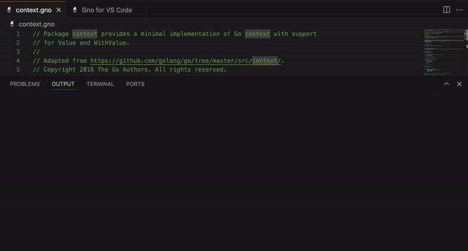
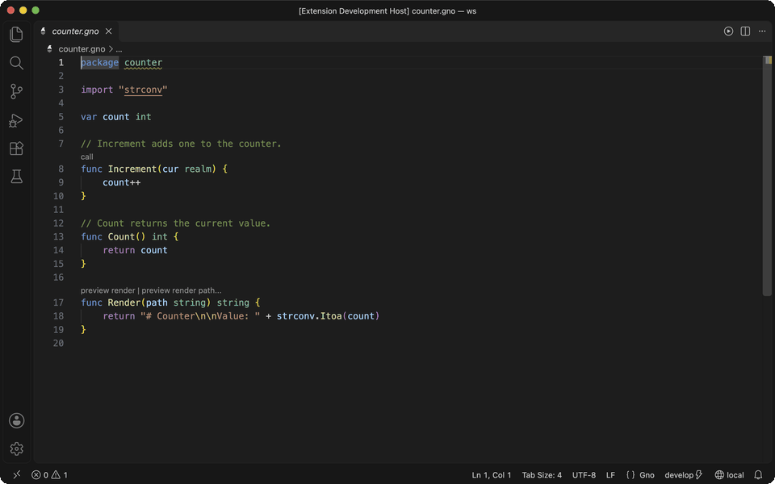
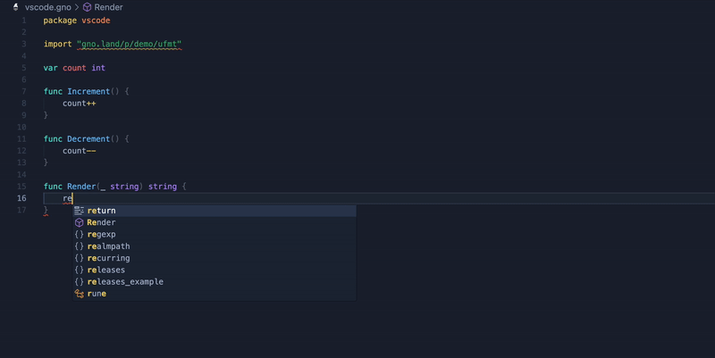
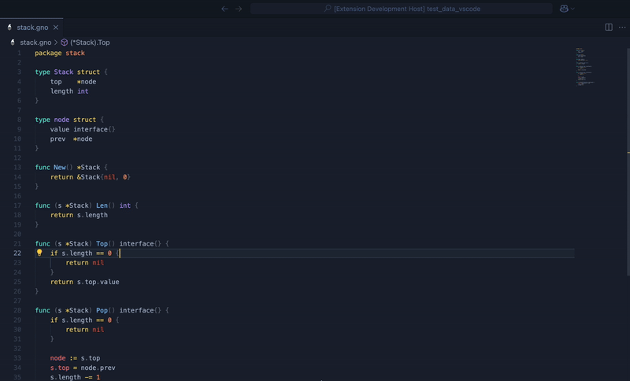

# Gno for Visual Studio Code

Welcome to the VS Code Gno extension!

This is an independently maintained fork of [gnoverse/vscode-gno](https://github.com/gnoverse/vscode-gno).

This extension provides rich language support for the Gno programming language, including features such as IntelliSense, code navigation, code editing, and testing.

## Requirements

* Visual Studio Code 1.91 or newer (or editors compatible with VS Code 1.91+ APIs)
* Go 1.25 or newer
* [Gno tools](https://docs.gno.land/builders/install): `gno`, `gnokey`, and `gnodev`

## Quick Start

1.  Install [Go](https://go.dev) 1.25 or newer (required for automatic installation of missing tools).

2.  Install `gno`, `gnokey`, and `gnodev` by following the [Gno installation guide](https://docs.gno.land/builders/install).

3.  Install the **VS Code Gnolang** extension.

    a. Download the `.vsix` file from
     [GitHub Releases](https://github.com/notJoon/vscode-gno/releases) and install it.

    b. Or build the `.vsix` file from source.

    See [Install from a VSIX](./docs/nightly-install.md) for the steps.

4.  Open any Gno file to automatically activate the extension. The
    **Gno status bar** appears in the
    bottom right corner of the window and displays your Gno version.

5.  The extension depends on `go`, `gno`, `gnopls` (the Gno language server), and optional
    tools (like `gnokey`) depending on your settings. If `gnopls` is missing, the extension will
    try to install it. The ⚡ sign next to the Gno version indicates the language server
    is running.

 
<em>(Install Missing Tools)</em>

You are ready to Gno! 🎉🎉🎉

## Feature highlights

* **IntelliSense** - Results appear for symbols as you type.
* **Code navigation** - Jump to or peek at a symbol's declaration.
* **Code editing** - Support for saved snippets, formatting and code organization, and automatic organization of imports.
* **Testing** - Run tests at the cursor, in the current file, or in the current package.
* **gnodev** - Start a local node from the editor and preview the `Render` output of your realm as you edit.
* **Realm interaction** - Call realm functions, run scripts, and query realms on the network you select.

 
<em>(Render preview with gnodev)</em>

 
<em>(Code completion and Signature Help)</em>

 
<em>(Toggle Test File)</em>

In addition to integrated editing features, the extension provides several
commands for working with Gno files. You can access any of these by opening the
Command Palette (`Ctrl+Shift+P` on Linux/Windows or `Cmd+Shift+P` on macOS), and
then typing in the command name.

## What's next

* Explore more [features](./docs/features.md) of the VS Code Gno extension.
* View the complete [command list](./docs/commands.md) provided by the extension.
* Customize the extension by changing [settings](./docs/settings.md).
* Explore Gno language resources on [docs.gno.land](https://docs.gno.land).
* Open an issue on [GitHub](https://github.com/notJoon/vscode-gno/issues/new) if you encounter any problems or have suggestions for new features.

## Contributing

We welcome your contributions and thank you for working to improve the Gno
development experience in VS Code. If you would like to help work on the VS Code
Gno extension, see our
[contribution guide](./docs/contributing.md) to
learn how to build and run the VS Code Gno extension locally and contribute to
the project.

## Credits

This extension is a fork of [gnoverse/vscode-gno](https://github.com/gnoverse/vscode-gno),
which itself derives from the [vscode-go](https://github.com/golang/vscode-go) extension for Go.
Thank you to the developers of both projects for their work and for the inspiration!

## License

[Apache License version 2.0](./LICENSE)
