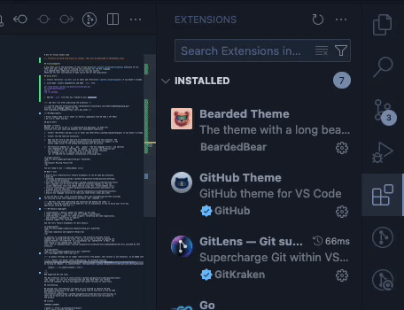

# Install from a VSIX

The VS Code Gno extension is distributed as a `.vsix` file on
[GitHub Releases](https://github.com/notJoon/vscode-gno/releases).

1. Download the latest `.vsix` file from
   [GitHub Releases](https://github.com/notJoon/vscode-gno/releases).

2. In VS Code, install the extension from the downloaded file:  
	a. Open the Command Palette (`Ctrl+Shift+P` on Linux/Windows and `Cmd+Shift+P` on macOS) and select `Extensions: Install from VSIX...`.  
	**OR**  
	b. Go to the Extensions view (`Ctrl+Shift+X` on Linux/Windows or `Cmd+Shift+X` on macOS), click on the ellipsis `...` in the top right corner, and select `Install from VSIX...`.

<p align="center">

<br/>
<em>(Install from VSIX)</em>
</p>

## Build from source

To build the `.vsix` file yourself, set up the repository as described in the [contribution guide](./contributing.md#setup), then run:

```bash
npm run package
```

This creates a `gnolang-<version>.vsix` file in the repository root. Install it with the steps above.
